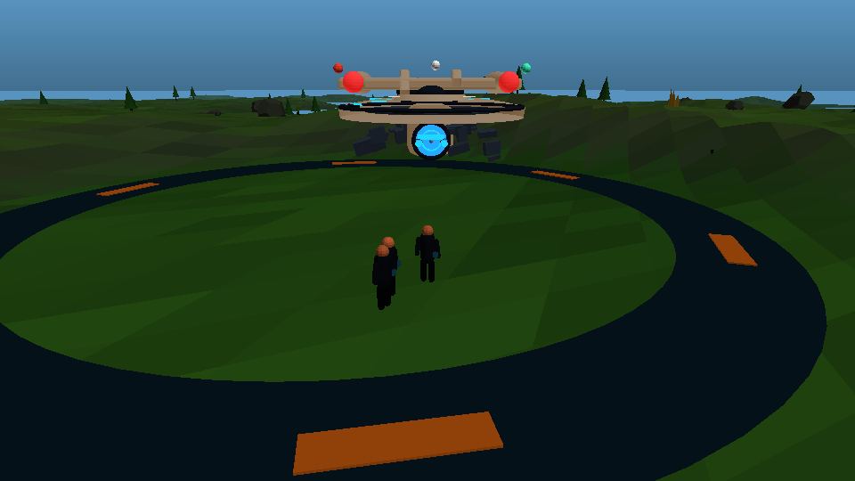
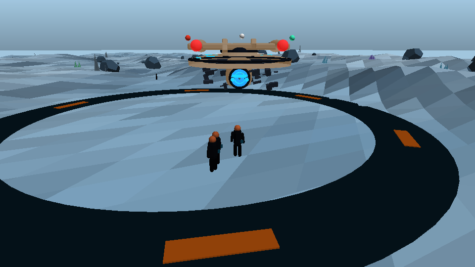

# Away missions

Landing used to be a copy of the survey text in a modal. It is now a scene you
actually walk around in: `src/scenes/planet.js`, with the world-building in
`src/art/surface.js`.

## Getting there

The orbit scene (`src/scenes/system.js`) watches the distance to every planet in
the current system. When the closest landable one is within 210 units
(`_nearestLandable()`), it raises a prompt:

- the **LAND** button in the action rail starts glowing,
- a `<div class="planet-prompt">` names the world and the distance,
- `L` (keyboard) and the *Land on the surface* button in the survey report do
  the same thing.

`Game.canLand(planet)` is the gate; `Game.landOn(planetId)` is the only way to
change state, and it is idempotent — landing on a world you have already visited
does not pay the discovery bonus again.

## The surface

`buildSurface()` in `src/art/surface.js` composes a whole world from the
planet's `id` (as a seed) and its `type` (as a biome):

| piece | what it does |
| --- | --- |
| `heightAt(x, z, seed, { relief })` | the ground height function. Flat inside `PAD_RADIUS` (11 u), full relief past `PAD_BLEND` (26 u), smoothstep between |
| `BIOMES` | ground tones, sky gradient, water level, fog and prop mix per biome (`m`, `ocean`, `desert`, `ice`, `volcanic`, `barren`, `gas`) |
| `biomeFor(id)` | draws from `PLANET_TYPES` in `src/data/galaxy.js`, falls back to `barren` |
| `isLandable(id)` | everything except `gas` |
| `buildTerrain()` | 340 u plane, 116 segments, vertex-coloured by altitude and slope |
| `buildScatter()` | 110 rocks, spires, shrubs and crystals, all placed outside the pad |
| `ringPoint()` | rejection-sampled polar placement, used by props, people and deposits |
| `buildPerson()` | low-poly figure with head/torso/limb handles for walk animation |

The landing site sits on a low rise (`MESA`, 2.6 u) that fades out by 150 u, so
an ocean world's sea plane cannot flood the pad and the first steps off the ring
are dry.

Everything is deterministic: `mulberry(seed)` and value-noise `fbm` mean the
same planet looks the same on every visit, in every session, on every device.
There is no saved terrain — the seed reconstructs it.

## What it looks like




These are **offline flat-shaded renders**, not screenshots: `npm run shot`
boots the real `PlanetScene` in jsdom and draws it with a small z-buffered
rasteriser, because this repo has no headless browser. They are for checking
composition — hull on the pad, away team framed, horizon where it should be —
and they deliberately show no textures, post-processing or bloom.

```
npm run shot -- --type=ice --out=shots/ice.png
```

Your ship is drawn **21 units long** rather than at true scale: a Galaxy class
is 641 m, and at 1 unit ≈ 1 metre it would be four hundred times the height of
the person standing in front of it. Every away-team game cheats this; the pad,
the ship and the horizon are framed together instead.

## Things to do

- **Walk.** `WALK_SPEED` 9.5 u/s, `RUN_SPEED` 17 with `Shift`, clamped to
  ±150 u. The camera trails at `9.5 × zoom` and never drops below the ground.
- **Talk** (`E`, range 4.6 u). NPCs face you while they speak and stop
  wandering. The first conversation with each person per planet pays 120–300
  credits and 6–16 research; after that they only chat.
- **Scan** (`R`, range 7.5 u). Deposits cycle dilithium (8–18 D), research
  (22–40 RP) and salvage (320–580 cr), 12 XP each, once per deposit.
- **Lift off** (`L`) to return to orbit, where the planet stays marked as
  visited.

## State and saves

`Game` keeps `state.landings` (per planet: `landedAt`, `finds`, `met`) and
`state.currentPlanetId`. Both are in the `SAVE_VERSION 5` payload, so the
"already got that" checks survive a reload. Nothing about the terrain itself is
stored.

## HUD

The surface screen uses the same drawer rail as every other screen
(`src/ui/drawers.js`): the vitals strip and the away-team panel are closed until
their rail button is pressed, so the view is not boxed in. `U` still hides
everything.
