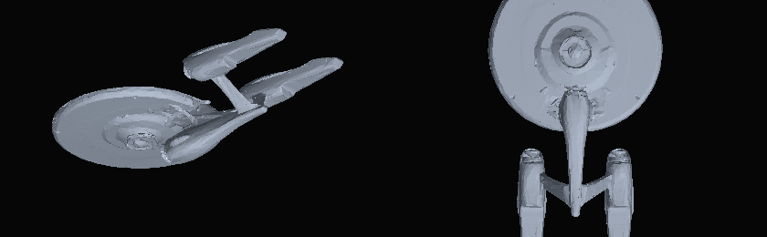

# Bringing your own ships (Meshy → game)

The game renders procedural hulls for all twenty-two classes. **Two already ship
with a high-detail model** — the Odyssey-class Enterprise-F and the Galaxy-class
Enterprise-D (see §2). Any of the remaining twenty can be replaced by a model
you made outside the game — the pipeline below is built for **Meshy** exports,
but it takes any GLB.

> The procedural hull never goes away. It is what you see for the first frame,
> and what you fall back to if a file is missing, corrupt or too heavy for the
> device. Nothing here can leave you with an invisible ship.

---

## 1. The short version

```bash
# 1. export from Meshy as GLB, rename it after the ship class
cp ~/Downloads/meshy_export.glb public/models/sovereign.glb

# 2. check it (size, poly count, textures, axis)
npm run models:check -- public/models/sovereign.glb

# 3. run the game — the manifest is rebuilt automatically
npm run dev
```

That is it. `npm run dev` and `npm run build` both regenerate
`public/models/manifest.json` first, and while the dev server is running the
folder is watched: **drop a file in and the page reloads with the new hull.**
One command if you prefer it manually: `npm run models:scan`.

---

## 2. What already ships with a real model

| class | ship | file | notes |
| --- | --- | --- | --- |
| `odyssey` | Odyssey-class, Enterprise-F | `odyssey.glb` | 86,607 tris, 11 MB, needs `"facing": "back"` |
| `galaxy` | Galaxy-class, Enterprise-D | `galaxy.glb` | 141,178 tris, 5.3 MB, converted from an OBJ |
| `saber` | Saber-class frigate *(AI stand-in)* | `saber.glb` | 49,662 tris, 2.54 MB, converted from an FBX, needs `"facing": "back"` |

The other nineteen classes use the procedural hull until you drop a file in.
Sources and licences for the three imported models are in
[CREDITS.md](CREDITS.md).

> The Saber model is **not** a canon-accurate mesh. It is a generic starship
> generated with Tripo AI, kept because its silhouette — saucer forward, compact
> engineering hull, twin nacelles aft — is the closest thing to a Saber we have
> in hand. It is the one imported hull here that does not come from a fan
> recreation of a specific canon design; if you have a real Saber mesh, drop it
> over `public/models/saber.glb` and nothing else needs to change.
>
> 

---

## 3. Which name for which ship

The filename *is* the mapping. Save the export as `<classId>.glb`, all
lower-case:

| classId | ship | classId | ship |
| --- | --- | --- | --- |
| `miranda` | Miranda / U.S.S. Reliant | `defiant` | Defiant |
| `nx` | NX-class Enterprise (NX-01) | `kelvinA` | Enterprise-A (Kelvin refit) |
| `constitution` | Constitution (NCC-1701) | `sovereign` | Sovereign (Enterprise-E) |
| `intrepid` | Intrepid / Voyager | `galaxy` | Galaxy (Enterprise-D) |
| `excelsior` | Excelsior | `prometheus` | Prometheus |
| `akira` | Akira | `vengeance` | Dreadnought (Kelvin) |
| `kelvin` | Kelvin-type (Kelvin) | `odyssey` | Odyssey (Enterprise-F) |
| `kelvinconn` | Constitution (Kelvin) | `franklin` | Freedom / Franklin (Kelvin) |
| `saber` | Saber (U.S.S. Yeager) | `steamrunner` | Steamrunner (U.S.S. Appalachia) |
| `nebula` | Nebula (U.S.S. Sutherland) | `ambassador` | Ambassador (Enterprise-C) |
| `crossfield` | Crossfield (U.S.S. Discovery) | `constitution3` | Constitution III (Enterprise-G) |

Ship-name filenames are understood too — `Enterprise.glb`, `USS_Voyager_NCC-74656.glb`,
`NCC-1701-E.glb`, `Reliant.glb` all resolve to the right class. Anything the
scanner cannot place is listed as skipped, with the valid ids, so a typo is
never silent.

---

## 4. Meshy export settings that matter

| Setting | Use | Why |
| --- | --- | --- |
| Format | **glTF Binary (.glb)** | one file, textures embedded; `.gltf` + sidecars lose their textures when copied |
| Poly count | low / medium (≈60k–150k tris) | the game flies whole squadrons; 1M-tri hero meshes stutter on phones |
| Texture size | **2K** | 4K is 4× the memory for no visible gain at play distance |
| PBR / metallic-roughness | on | the game relights the model with its own sun, rim light and warp glow |
| Rig / animation | none | a hull should not be rigged; animations are ignored |
| Symmetry | on | mismatched nacelles are very visible in a chase camera |

Roughly: **under 15 MB is comfortable, 40 MB is the hard warning line.**

Orientation does not have to be right in Meshy — see §5 — but if you want it
correct at source, model **nose toward +Z, up toward +Y**.

---

## 5. What the game does to your model

On load (asynchronously, in the background) the importer:

1. **rescales** the longest side to the hull length the game already uses for
   that class, so a 1,000-unit or 0.3-unit export both end up the right size;
2. **centres** it on the origin, so the pivot is not at the corner of the file;
3. **finds the long axis** and rotates it onto Z — a hull modelled along X, or
   exported standing on its tail along Y, lines up automatically;
4. **assumes nose +Z** (the Meshy convention) — one line in
   `models.config.json` fixes an export that faces −Z;
5. **rebuilds the anchors** — phaser muzzles, torpedo tubes and engine glow are
   re-placed from the real model's bounds, so weapons fire from the hull you
   actually see and the warp trail comes off the actual stern;
6. **prepares materials** — env-map intensity, metalness/roughness sanity,
   shadow flags, tone mapping left to the renderer;
7. **parks the procedural hull** (hidden, not deleted) so a later failure can
   restore it instantly.

Hardpoints that cannot be derived from a single mesh — where exactly the phaser
strips sit — keep their procedural positions, projected onto the new hull's
size. Everything that reads as "the tip of the ship" is recomputed.

---

## 6. Fine-tuning: `models.config.json`

Only needed when the automatic result is wrong. Create
`models.config.json` in the repo root; it is read by the scanner and merged into
the manifest:

```json
{
  "constitution": { "facing": "back" },
  "sovereign": { "yawDeg": 90, "scale": 1.05 },
  "defiant": { "yOffset": -0.15 }
}
```

| key | meaning |
| --- | --- |
| `facing` | `"front"` (default — nose is +Z) or `"back"` (model faces −Z; flips 180°) |
| `yawDeg` | extra rotation about Y, in degrees, applied after `facing` — use 90/270 for a hull modelled sideways |
| `scale` | multiplier on top of the automatic fit — e.g. `0.95` to tuck a hull inside the collision radius |
| `yOffset` | vertical shift in hull lengths — `-0.1` sits it lower, useful when a model floats above its pivot |

Rules of thumb while tuning:

- **Facing backwards** (warp glow at the nose) → `"facing": "back"`.
- **Lying on its side** (nacelles pointing left/right) → `"yawDeg": 90` (or 270).
- **Too big / clips the camera** → `scale: 0.9`; too small → `1.1`.
- **Hovers above the reticle** → `yOffset: -0.1`.

Overrides can also be applied at runtime from the browser console while the
game is running, which is faster than a reload if you are tuning by eye:

```js
import('/src/art/imported.js').then((m) => m.setOverride('sovereign', { facing: 'back' }));
```

---

## 7. Checking a file before you commit it

```bash
npm run models:check -- public/models/akira.glb
```

```
akira.glb
────────────────────────────────────────────────────
container      glTF 2 binary, 8.42 MB
geometry       74,318 triangles · 1 primitive(s) · 1 mesh(es)
scene graph    6 node(s) · 4 material(s)
textures       3 image(s) · 7.90 MB embedded
model bounds   1060.00 × 180.00 × 240.00 units
long axis      X · longest side 1060.0u
scale note     units are arbitrary — the game rescales to the hull length

· hull is modelled along X — the importer rotates it onto Z automatically
```

The checker reads the GLB container directly (no dependencies, no browser), so
it also catches the failure the game cannot report nicely: an `.fbx`, `.obj` or
`.usdz` renamed to `.glb`.

It reports only the container, geometry and texture weight; it does not render.
For that, `npm run dev` and look at the hangar.

---

## 8. Troubleshooting

| symptom | cause | fix |
| --- | --- | --- |
| hull looks exactly as before | file name not a known classId | run `npm run models:scan` and read the "skipped" list |
| hull missing, procedural ship shown | load failed (not a GLB, truncated download) | `npm run models:check -- <file>`; re-export |
| white/black untextured hull | textures not embedded | re-export as **GLB**, not `.gltf` + folder |
| ship faces backwards | export faces −Z | `{ "facing": "back" }` |
| nacelles point left/right | modelled along X | `{ "yawDeg": 90 }` |
| warp trail from the nose | override and auto-facing disagree | remove the override, re-check |
| long first load on mobile | heavy textures | 2K textures, medium poly, < 15 MB |
| model appears huge / tiny | irrelevant — auto-fit | only use `scale` for artistic trim |

Fastest loop: `npm run dev`, console open, drop the file in, read the
`[models]` line vite prints, tune with `setOverride`, then write the winning
values into `models.config.json`.

---

## 9. Converting an OBJ / FBX / OBJ-style asset

Not everything arrives from Meshy. The two models that ship with the game came
from GitHub as an OBJ and a GLB, and the OBJ needed the same three steps any
non-Meshy asset needs — convert, decimate, and (optionally) shrink textures:

```bash
# OBJ (with .mtl + jpg textures sitting next to it) -> GLB
npx obj2gltf -i ship.obj -o ship.glb -b

# weld + join draw calls + simplify + shrink textures, no runtime decoder needed
npx @gltf-transform/cli optimize ship.glb public/models/<classId>.glb \
  --compress quantize --simplify-error 0.002 \
  --texture-size 2048 --texture-compress webp

npm run models:check -- public/models/<classId>.glb
```

Rules that came out of doing it for real:

- **Decimate.** 600k triangles at 44 materials became 141k triangles at 1.36 MB
  instead of 24 MB — visually identical at play distance, and flyable on a
  phone.
- **Join meshes.** 1,366 separate nodes is 1,366 draw calls per ship. After
  `optimize` it was 24.
- **Prefer `quantize` over `draco`/`meshopt`** unless you want to wire up a
  decoder: quantization needs nothing at runtime.
- **WebP textures** cut the texture payload roughly in half at no visible cost
  in this game's lighting.

FBX needs one extra hop (`blender --background --python-expr` or any FBX→glTF
converter) — `obj2gltf` only reads OBJ. If you have the choice, ask the tool
for glTF/GLB directly.

---

## 10. Where the code lives

| path | role |
| --- | --- |
| `src/art/imported.js` | manifest fetch, GLTFLoader + Draco cache, normalisation, material prep, hot-swap, overrides |
| `scripts/scan-models.mjs` | folder → manifest, alias table, config merge |
| `scripts/check-model.mjs` | dependency-free GLB inspector (`npm run models:check`) |
| `public/models/` | your exports + the generated `manifest.json` |
| `public/draco/` | decoder for Draco-compressed exports |
| `models.config.json` | optional per-class overrides |

`buildShip(classId, record, quality, { importModel: false })` opts a hull out of
importing entirely — useful for previews and tests that need the procedural
version. Imported geometry is cached and shared between instances of the same
class, so ten Mirandas cost one upload.
